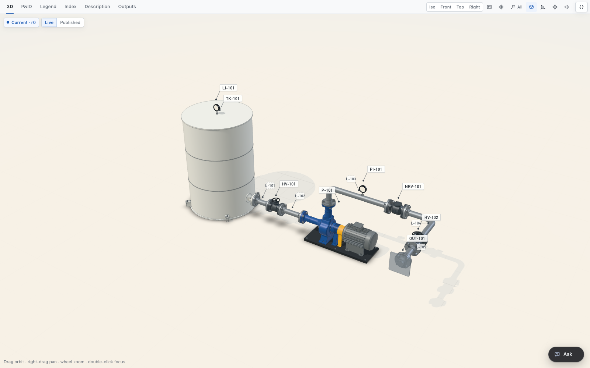
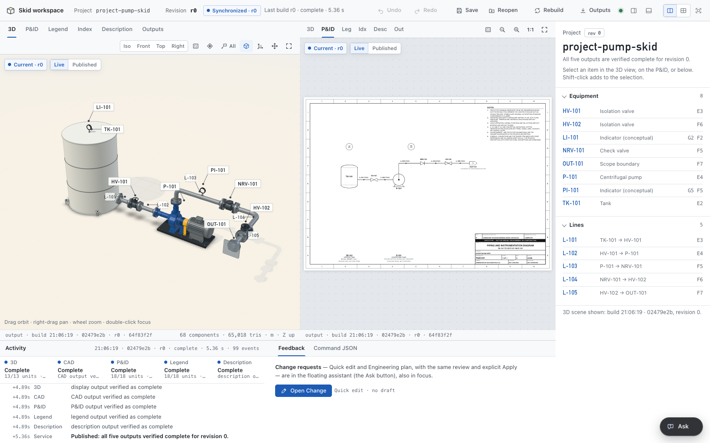

# 3d-with-pid

A small, MIT-licensed prototype project that generates the P&ID and the 3D/STEP model of an equipment package from one engineering model, keeps permanent IDs apart from editable tags and marks any drawing or model it cannot update as pending.



In most plant design tools the P&ID and the 3D model are two datasets: "changes made to the P&ID drawing are not automatically reflected in the model" ([Autodesk Plant 3D help](https://help.autodesk.com/cloudhelp/2017/ENU/PNID/files/GUID-C665364F-BDBE-4254-9156-0C8C441AA88D.htm)). Mismatches surface later, in a check such as Plant 3D Validate, Smart 3D Compare Design Basis or AVEVA Schematic 3D Integrator. This prototype generates both views from one model, so each change updates the outputs or marks them pending until someone resolves it.

## What a change looks like

Rename the pump, then move it 0.2 m. The tag changes in every output and the ID `ent-pump` stays. The two pump lines go pending with their old points kept; the P&ID layout is untouched. New routes make the model current again.

*Real output, shortened. Command files: [walkthrough](docs/REFERENCE_EXAMPLE.md#hands-on-edits-standard-library-only).*

Each revision produces five outputs: the 3D view, STEP CAD, the P&ID sheet, a legend sheet and an item index with a process description. The browser workspace shows them side by side with a status badge on each.



*Revision 0, all five outputs current. Readable sheet: [P&ID (SVG)](docs/media/pid.svg).*

## Status and limits

Engineering prototype, released as is. No further development is planned unless it is specifically asked.

- Every dimension in the examples is an illustrative assumption. No independent engineering review or sign-off is recorded ([criteria](docs/ENGINEERING_REVIEW.md)).
- Nothing here is a process design, a fabrication drawing or a claim of ISA-5.1, ISO 10628 or other standards conformance.
- DN50 liquid service only. No process or column design, whole-plant layout or automatic routing. Linux and macOS only. Full list: [capabilities and limits](docs/CAPABILITIES.md#not-supported). Known gaps are [issues](https://github.com/nusretfurkan/3d-with-pid/issues?q=label%3Aknown-gap); none is scheduled.
- Verification record: [repository assessment](docs/REPOSITORY_ASSESSMENT.md). Fixture origins: [provenance](docs/FIXTURE_PROVENANCE.md), [images](docs/media/PROVENANCE.md).

## Work with me

I'm Nusret Furkan, a process engineer and co-founder of [Plexus](https://processengineer.io). At Plexus we build AI tools for process and safety engineering teams: they pull values from project documents, trace each one to its source and check them for conflicts across revisions. I built 3d-with-pid to test a related idea on P&ID and 3D consistency.

- Pilot of existing tools/products (paid, scoped per case).
- Consulting
- Custom product development

[nusret@processengineer.io](mailto:nusret@processengineer.io) · [LinkedIn](https://www.linkedin.com/in/nusretfurkan) · [Book an introduction call](https://calendar.app.google/KRXf9SM88DWTQ7yi6) · Questions and test cases: [Discussions](https://github.com/nusretfurkan/3d-with-pid/discussions)

## Try it

Linux or macOS, Python 3.12:

```sh
python3.12 -m venv .venv-cad && . .venv-cad/bin/activate
mkdir -p work
python -m skid.cli sample work/skid.json        # copy of the example pump skid
python -m skid.cli validate work/skid.json      # standard library only, no installs

python -m pip install -r requirements-cad.txt   # CadQuery, for the five-output workspace
python -m skid.interactive --project work/skid.json --port 0    # opens a loopback-only workspace
```

Full guide: [getting started](docs/GETTING_STARTED.md).

<details>
<summary><b>Starter prompts for a coding agent</b> (pump skid, distillation column shape)</summary>

Both were tested once with Claude Code on a fresh clone; other agents are untested.

**Pump skid.** Rename, move, pending, reroute:

```text
Read README.md and docs/REFERENCE_EXAMPLE.md. Use Python 3.12 as in the README quick start. If
work/pump/ exists, list it and stop. Otherwise create a copy of the pump-skid example at
work/pump/project.json with `python -m skid.cli sample`, and keep any command files you write in
work/pump/. Rename the pump P-101 to P-201. Then move it with a move_equipment command from
position_m [1.5, 0, 0] to [1.7, 0, 0]. Show me which lines went pending and why. Propose new routes
for the affected lines as one batch and wait for my OK before applying. Then validate, and tell me
how to open the workspace (`python -m skid.interactive --project work/pump/project.json --port 0`)
to see the 3D view and P&ID together.
```

**Distillation column, illustrative shape only:**

```text
Read README.md, docs/EMPTY_START.md and docs/EQUIPMENT.md. Use Python 3.12 as in the README quick
start. If work/column/ exists, list it and stop. Create an empty project with
`python -m skid.cli new work/column/project.json --name "Column sketch"`, and keep every file you
write in work/column/. Author one composed_equipment definition for an illustrative vertical
distillation column shell: a vertical cylindrical shell with heads and a skirt, symbol shape
vertical_vessel, and DN50 liquid ports for feed (in), reflux (in) and bottoms (out). The tool
supports liquid service only, so leave the overhead vapour line out and list it as an unknown,
together with stages, trays or packing, diameter sizing, duty, pressure, temperature and materials.
Add it with add_equipment as C-101, placed at the origin with an illustrative layout assumption;
docs/EMPTY_START.md has a complete add_equipment example for composed equipment. Leave its ports
unresolved and report the validate exit status as it is. Do not state any process or mechanical
design.
```

</details>

**Optional AI planning.** In the workspace, **Change → Engineering plan** sends your request and a project snapshot to `claude-opus-5-5` through your own Claude Code CLI and returns a dry-run command batch; nothing is applied until you click Apply. It is off unless requested. Any coding agent can do the same by writing command files ([what leaves your machine](docs/CAPABILITIES.md#optional-ai-planning-and-research)).

## Documentation

- [Getting started](docs/GETTING_STARTED.md) · [Capabilities and limits](docs/CAPABILITIES.md) · [Troubleshooting](docs/TROUBLESHOOTING.md)
- [Reference example](docs/REFERENCE_EXAMPLE.md) · [Empty start](docs/EMPTY_START.md) · [Input contracts](docs/INPUT_CONTRACTS.md)
- [Working with AI agents](docs/AGENT_WORKFLOWS.md) (including a [fresh development agent prompt](docs/AGENT_WORKFLOWS.md#starting-a-fresh-development-agent)) · [Agent instructions](AGENTS.md) · [Handover](HANDOVER.md)
- [Engineering review criteria](docs/ENGINEERING_REVIEW.md) · [Contributing](CONTRIBUTING.md) · [Security](SECURITY.md)
- [Licensing](docs/LICENSING.md) · [Third-party notices](THIRD_PARTY_NOTICES.md) · [Public-contents audit](docs/PUBLIC_CONTENTS_AUDIT.md) (historical)

## Licence

[MIT](LICENSE) for project-authored material, including docs, examples, fixtures and `docs/media/`. Seven Blender integration files are [GPL-3.0-or-later](LICENSES/GPL-3.0-or-later.txt), with an additional permission for generated deliverables ([details](docs/LICENSING.md#gpl-exceptions-blender-integration)). Vendored Three.js keeps its own MIT licence; Blender and other dependencies are installed separately under their own terms ([NOTICE](NOTICE)). This is a reasoned licensing assessment, not a legal opinion.
